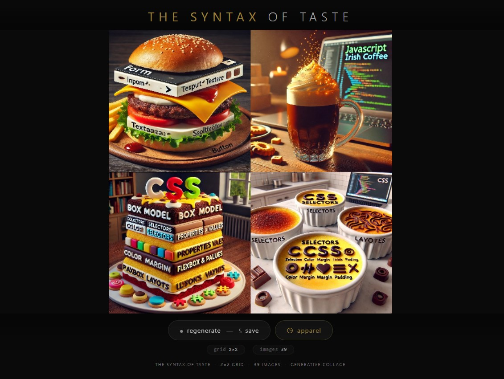
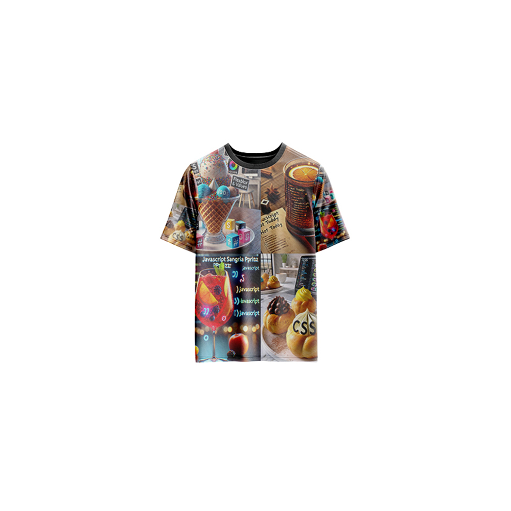

# The Syntax of Taste — Generative Art

[](https://reyrove.github.io/The-Syntax-of-Taste-Generative-Art)
[](https://opensource.org/licenses/MIT)

> **Generative collage art with 39 curated images.** Each refresh creates a unique 2×2 grid composition, randomly selecting and arranging images to form new visual conversations and unexpected juxtapositions.

## 🎨 Live Demo

<div align="center">
  <a href="https://reyrove.github.io/The-Syntax-of-Taste-Generative-Art" target="_blank">
    
  </a>
  <br><br>
  <a href="https://reyrove.github.io/The-Syntax-of-Taste-Generative-Art" target="_blank">
    
  </a>
  <br>
  <em>Click the image or button to experience the generative art</em>
</div>

## 👕 Apparel Preview

<div align="center">
  
  <br>
  <em>The Syntax of Taste artwork printed on a T-shirt</em>
</div>

## ✨ Features

- **Generative Collage** — 39 images arranged in a 2×2 grid
- **Random Selection** — Each cell randomly selects from the image library
- **Unique Combinations** — Over 2 million possible arrangements
- **No Duplicates** — Algorithm tries to avoid repeated images
- **Save & Share** — Download as PNG
- **Apparel Mode** — Preview artwork on a T-shirt mockup
- **Responsive** — Works on desktop, tablet, and mobile
- **p5.js Powered** — Built with the creative coding library
- **Keyboard Shortcuts**:
  - `R` — Regenerate
  - `S` — Save image
  - `T` — Toggle apparel view
  - `Space` — Regenerate

## 🎨 Artwork Details

| Parameter | Value | Description |
|-----------|-------|-------------|
| **Grid Size** | 2×2 | Four cells total |
| **Image Library** | 39 images | Curated collection |
| **Selection** | Random | Each cell independently selected |
| **Arrangement** | 2×2 grid | Two columns, two rows |

## 🎯 Visual Experience

### The Grid
- 2×2 layout creates balanced compositions
- Each cell fills exactly one quarter of the canvas
- Images are displayed full-frame within each cell

### The Collection
- 39 curated images from various sources
- Diverse visual content and styles
- Each image tells its own story

### The Combination
- Random selection creates unexpected juxtapositions
- Each arrangement generates new visual meanings
- The "syntax" of how images relate to each other

## 🚀 Quick Start

### Local Development

```bash
# Clone the repository
git clone https://github.com/reyrove/The-Syntax-of-Taste-Generative-Art.git

# Navigate to the directory
cd The-Syntax-of-Taste-Generative-Art

# Make sure images are in the images folder
# images/image1-min.jpg through images/image39-min.jpg

# Open in browser
open index.html
# or use a live server
```

### Deploy to GitHub Pages

1. Push to GitHub
2. Go to Settings → Pages
3. Select branch `main` and root folder
4. Your site will be live at `https://reyrove.github.io/The-Syntax-of-Taste-Generative-Art`

## 📁 File Structure

```
The-Syntax-of-Taste-Generative-Art/
├── index.html              # Main application (all-in-one)
├── The-Syntax-of-Taste.jpg # T-shirt mockup image
├── fav.svg                 # Favicon
├── demo-screenshot.jpg     # Website demo screenshot
├── README.md               # This file
├── LICENSE                 # MIT License
└── images/                 # Image library
    ├── image1-min.jpg
    ├── image2-min.jpg
    ├── ...
    └── image39-min.jpg
```

## 🛠️ Tech Stack

- **p5.js** — Creative coding library
- **Canvas API** — 2D rendering
- **CSS Flexbox/Grid** — Responsive layout
- **GitHub Pages** — Hosting

## 🎯 Interactive Controls

| Action | Keyboard | Button |
|--------|----------|--------|
| Regenerate | `R` or `Space` | Click "regenerate" |
| Save Image | `S` | Click "regenerate" |
| Toggle Apparel | `T` | Click "apparel" |

## 🎨 The Creative Process

### Curated Collection
The 39 images are carefully selected to represent diverse visual content. Each image is a distinct "word" in the visual vocabulary of the artwork.

### Random Syntax
The 2×2 grid becomes a sentence where each image is a word. The random arrangement creates new meanings and relationships with each generation.

### Visual Dialogue
The juxtaposition of different images creates a visual dialogue. The viewer interprets the relationships between the four images, finding meaning in their arrangement.

### Infinite Combinations
With 39 images and 4 positions, there are over 2 million possible combinations (39 × 38 × 37 × 36), ensuring each viewing is unique.

## 📱 Responsive Design

The application automatically adapts to:
- Desktop screens
- Tablets
- Mobile phones
- Landscape orientation
- Various aspect ratios
- Small screens (down to 380px wide)

## 🤝 Contributing

Contributions are welcome! Feel free to:
- Fork the repository
- Create a feature branch
- Submit a pull request

### Ideas for Contributions:
- Additional images
- Different grid sizes
- Animation features
- Interactive controls
- More apparel mockups

## 📄 License

MIT License — see [LICENSE](LICENSE) file for details.

## 🙏 Acknowledgments

- Created with p5.js
- Inspired by collage art and visual syntax
- Special thanks to the creative coding community

---

**Built with ❤️ and collage dreams**